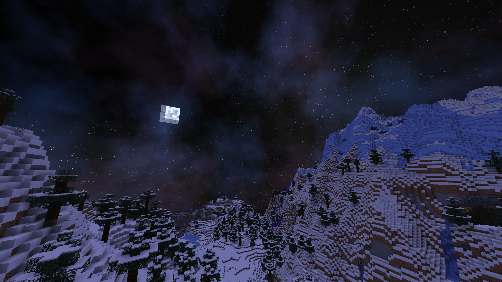

# Night Sky Shaders
A beautiful Minecraft Night Skybox, but without OptiFine\
Using Minecraft's Vanilla Shaders implementation
## Credits
This pack was originally created by [Selicre](https://selic.re)\
And the original resourcepack was uploaded on [this Reddit post](https://www.reddit.com/r/Minecraft/comments/m36l6d/21w10a_shaders_let_you_make_completely_custom/)\
He gave me the authorization to update and upload it on platforms like Modrinth and GitHub\
A huge thanks to him
## Compatibility
Every Minecraft versions starting from Minecraft 1.17\
(expect for 1.21.5 because Mojang broke the `ScreenSize` uniform)
## Download
Go to the [releases](https://github.com/DelofJ/NightSkyShaders/releases) and download it for your version of Minecraft
## What it looks like

